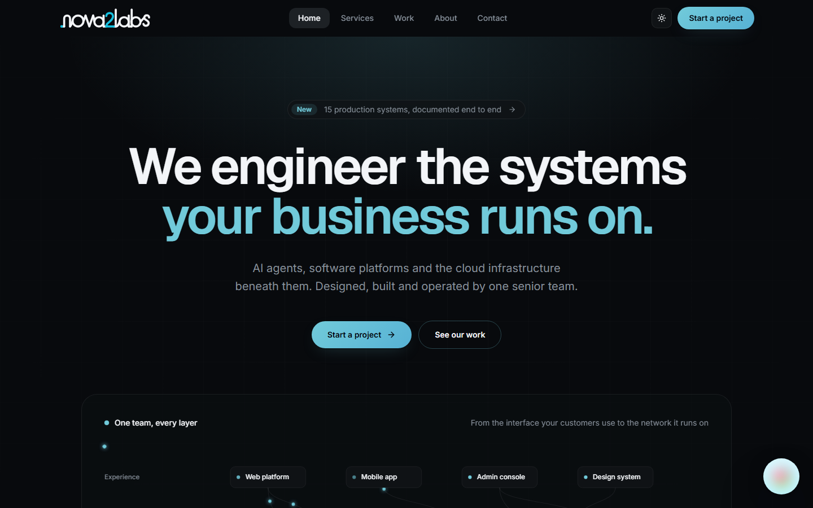
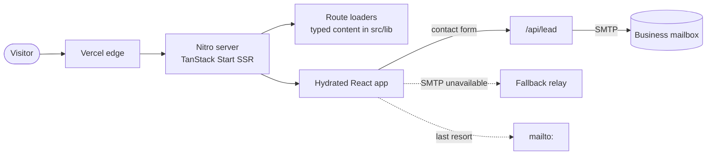
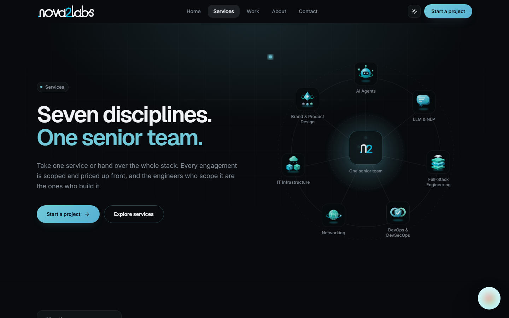
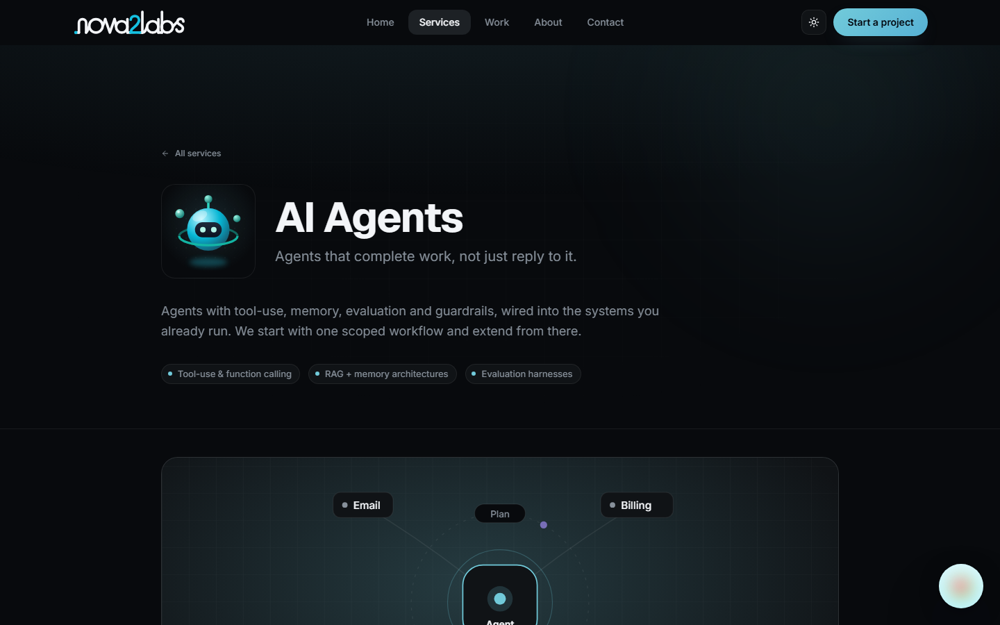
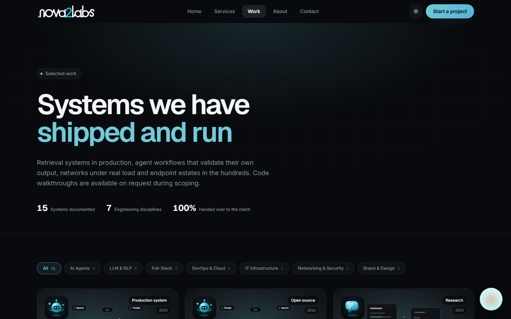

<div align="center">

<picture>
  <source media="(prefers-color-scheme: dark)" srcset=".github/assets/logo-dark.svg" />
  
</picture>

### Production website for an AI, software and infrastructure studio

[**nova2labs.com**](https://www.nova2labs.com) · server-rendered, SEO-complete, zero stock imagery

[](https://github.com/Muhammadhammad24/nova2labs/actions/workflows/ci.yml)




</div>

## Overview

nova2labs builds AI agents, LLM products, full-stack platforms and the cloud,
network and IT infrastructure beneath them. This repository is the company
website: a fast, server-rendered marketing site that explains seven service
lines, presents case studies and turns visitors into qualified leads.

It is built like a product, not a template. Every illustration is generated in
code, both colour themes are designed rather than inverted, and the contact
form delivers straight to the business mailbox over SMTP.

## Highlights

- **Server-side rendering with file-based routing.** TanStack Start renders every
  page on the server, then hydrates. Service and case-study pages come from typed
  data, one route file each.
- **Generative artwork instead of stock photos.** `Artwork.tsx` draws animated SVG
  diagrams (agent loops, delivery pipelines, network meshes, server racks) from a
  seed, in the site's own colour tokens. Every placement is unique, and they all
  follow the theme.
- **A designed light and dark theme.** Colours are OKLCH tokens in `styles.css`.
  The 3D service icons ship in a separate variant for each theme.
- **Lead capture that doesn't depend on a third party.** `/api/lead` validates the
  input on the server and sends through the company's own SMTP mailbox with Nodemailer. If SMTP
  is down it falls back to a relay, then to `mailto:`, so no enquiry is lost.
- **SEO included.** Per-page titles, canonical URLs, Open Graph and Twitter cards,
  a generated `sitemap.xml`, and JSON-LD for Organization, Service, FAQ and
  breadcrumbs.
- **Accessible and considerate.** Semantic landmarks, keyboard-reachable
  interactions, visible focus, and reduced-motion support for the site's animation.
- **Resilient SSR.** `src/server.ts` catches unhandled render failures and serves
  a branded error page in place of a raw 500.

## Architecture



Content lives in typed modules (`services-data.ts`, `work-data.ts`) rather than a
CMS, so every page is checked by the compiler and rendered in a single request.

## Quality gates

Every push and pull request runs [CI](.github/workflows/ci.yml): a strict
TypeScript check, ESLint with zero warnings allowed, a Prettier check and a
production build. Dependabot keeps dependencies current, with grouped weekly
updates.

```bash
npm run check   # typecheck, lint and formatting, the same gates as CI
```

## Screenshots

| Services                                                                                           | Service detail                                                                 |
| -------------------------------------------------------------------------------------------------- | ------------------------------------------------------------------------------ |
|  |  |



## Tech stack

| Layer            | Choice                                                                |
| ---------------- | --------------------------------------------------------------------- |
| Framework        | React 19, TanStack Start and Router (SSR, file routes, server routes) |
| Language         | TypeScript (strict)                                                   |
| Styling          | Tailwind CSS 4, OKLCH design tokens                                   |
| Motion           | Motion, SVG and SMIL animation                                        |
| Forms            | React Hook Form and Zod                                               |
| Email            | Nodemailer over SMTP                                                  |
| Build and deploy | Vite 7, Nitro (Vercel preset)                                         |

## Project structure

```
src/
├─ routes/                 # file-based routes
│  ├─ index.tsx            # home
│  ├─ services.tsx         # services overview
│  ├─ services_.$slug.tsx  # one page per service
│  ├─ work.tsx             # case studies
│  ├─ work_.$slug.tsx      # case-study detail
│  ├─ api.lead.ts          # POST /api/lead → SMTP
│  └─ sitemap[.]xml.ts     # generated sitemap
├─ components/
│  ├─ Artwork.tsx          # seeded generative SVG illustrations
│  ├─ ServiceOrbit.tsx     # services hero
│  ├─ StackVisual.tsx      # home hero diagram
├─ lib/
│  ├─ site.ts              # brand constants, SEO and JSON-LD helpers
│  ├─ services-data.ts     # service content
│  ├─ work-data.ts         # case-study content
│  └─ lead.ts              # client-side lead delivery with fallbacks
└─ styles.css              # design tokens and theme
.github/
├─ workflows/ci.yml        # typecheck, lint, format and build on every push
└─ dependabot.yml          # grouped dependency updates
scripts/
└─ og-image.mjs            # renders the Open Graph image
```

## Getting started

Requires Node.js 20.19 or later (`.nvmrc` pins 22).

```bash
npm install
cp .env.example .env   # set the site URL and SMTP credentials
npm run dev            # http://localhost:5173
```

| Script            | Purpose                                                           |
| ----------------- | ----------------------------------------------------------------- |
| `npm run dev`     | Development server with HMR                                       |
| `npm run build`   | Production build (set `NITRO_PRESET` to choose the deploy target) |
| `npm run preview` | Serve the production build locally                                |
| `npm run lint`    | ESLint and Prettier checks                                        |

### Environment

| Variable                                           | Scope            | Purpose                                          |
| -------------------------------------------------- | ---------------- | ------------------------------------------------ |
| `VITE_SITE_URL`                                    | public           | Canonical origin for SEO, sitemap and Open Graph |
| `SMTP_HOST`, `SMTP_PORT`, `SMTP_USER`, `SMTP_PASS` | server           | Mailbox the contact form delivers to             |
| `VITE_WEB3FORMS_KEY`                               | public, optional | Fallback relay if SMTP is unavailable            |

Secrets stay on the server; only `VITE_*` values reach the browser.

## Deployment

The site deploys to Vercel. `vercel.json` builds with `NITRO_PRESET=vercel` and
serves `.output/public`. Add the environment variables above in the Vercel
project settings.

## License

Copyright © 2026 nova2labs. All rights reserved. See [LICENSE](LICENSE).
